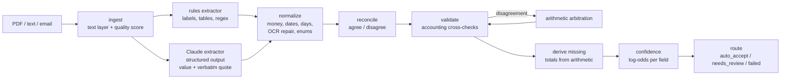

# Change-Order Extractor

Turns messy construction change orders (formal PDFs, emails, OCR'd scans, field notes) into **validated JSON with a confidence score for every field**, and decides which documents are safe to auto-accept and which need a human.

> **The task:** build a change-order extraction pipeline that turns messy change-order PDFs or text into validated JSON with per-field confidence scores, with a short write-up of the approach and its failure modes.
>
> **Write-up:** [docs/WRITEUP.md](docs/WRITEUP.md) covers the approach, results, and failure modes.

---

## Contents

- [Quick start](#quick-start)
- [What it produces](#what-it-produces)
- [Architecture](#architecture)
- [Schema](#schema)
- [How confidence is computed](#how-confidence-is-computed)
- [Validation rules](#validation-rules)
- [Evaluation](#evaluation)
- [Sample corpus](#sample-corpus)
- [Project layout](#project-layout)
- [Design decisions](#design-decisions)
- [Limitations](#limitations)

---

## Quick start

Requires Python 3.12+ and [uv](https://docs.astral.sh/uv/).

```bash
uv sync

# Offline: rules extractor only, no API key needed
uv run co-extract samples/co_001_formal.pdf --no-llm

# With an LLM as the primary extractor -- Claude or Gemini (Gemini has a free tier)
echo 'GEMINI_API_KEY=your-key' >> .env        # or ANTHROPIC_API_KEY=sk-ant-...; .env is git-ignored
uv run co-extract samples/co_002_email.txt
uv run co-extract samples/co_002_email.txt --provider gemini --model gemini-3.6-flash

# A whole folder, one JSON file per document, with a summary line each
uv run co-extract samples/ -o out/ --summary

# Tests and evaluation
uv run pytest
uv run python eval/evaluate.py                  # dev set, rules only
uv run python eval/evaluate.py --set holdout    # held-out set
uv run python eval/evaluate.py --llm            # with the LLM (needs a key)
uv run python eval/evaluate.py --llm --provider gemini
```

The LLM extractor turns on automatically when a key is found in the environment or in `./.env`. With `--provider auto` (the default) it uses Claude if `ANTHROPIC_API_KEY` is set, otherwise Gemini if `GEMINI_API_KEY` (or `GOOGLE_API_KEY`) is set. `--no-llm` forces rules-only. Default models are `claude-opus-5-5` (override with `CO_EXTRACT_MODEL`) and `gemini-3.6-flash` (override with `GEMINI_MODEL`); `--model` overrides either. Both providers use the same prompt, JSON schema and verbatim-quote contract, so everything downstream treats them identically.

Gemini calls time out after 60 s (`GEMINI_TIMEOUT_MS`), and busy (429/5xx) responses are retried 3 times with backoff, with progress printed to stderr. If the model is still unavailable, the document falls back to the rules extractor and the output's `meta.llm_error` says so. By default one model reads every document, so results are consistent. To try other models when it is overloaded, set e.g. `GEMINI_FALLBACK_MODELS=gemini-3.7-flash`.

> **Note:** on Google's free tier, prompts may be used to improve Google's products. Don't send confidential change orders through a free-tier key.

From Python:

```python
from co_extract import run

result = run("samples/co_004_credit.pdf")
result.status                                  # "auto_accept" | "needs_review" | "failed"
result.fields["total_change_amount"].value     # -4950.0
result.fields["total_change_amount"].confidence
result.change_order                            # clean dict, validated against the ChangeOrder schema
```

## What it produces

Every field is wrapped in an envelope with its value, confidence, where it came from, the verbatim quote it was read from, machine-readable flags, and the reasons behind the confidence score. Here is an excerpt from [examples/output/co_005_inconsistent.json](examples/output/co_005_inconsistent.json), a contractor proposal whose line items don't add up to its own subtotal:

```jsonc
{
  "document": "co_005_inconsistent.txt",
  "status": "needs_review",
  "overall_confidence": 0.873,
  "needs_review": ["line_items[0]", "line_items[1]", "line_items[2]", "reason", "subtotal"],
  "validation": [
    { "rule": "items_sum_to_subtotal", "severity": "error",
      "message": "line items sum 8450.00 vs subtotal 8540.00", "fields": ["subtotal"] }
  ],
  "fields": {
    "subtotal": {
      "value": 8540.0,
      "confidence": 0.823,
      "sources": ["rules"],
      "evidence": "Subtotal                                       8,540.00",
      "flags": ["failed_validation"],
      "reasons": [
        "extractor certainty 0.85",
        "+ quote found verbatim in document",
        "+ 1 arithmetic check(s) pass",
        "- 1 arithmetic check(s) fail"
      ]
    },
    "total_change_amount": { "value": 9394.0, "confidence": 0.858, "...": "..." }
    // ... all 19 scalar fields
  },
  "line_items": [ { "fields": { "description": {...}, "amount": {...} }, "confidence": 0.406, "evidence": "..." } ],
  "change_order": { /* clean typed object, present when the schema validates */ },
  "meta": { "input_kind": "text", "text_quality": 1.0, "extractors": ["rules"], "checks_passed": [...] }
}
```

The output for every sample is in [examples/output/](examples/output/), generated offline.

## Architecture



| stage | module | what it does |
|---|---|---|
| ingest | [ingest.py](src/co_extract/ingest.py) | Reads text and PDFs (pdfplumber, layout-preserving). Detects image-only PDFs. Scores text quality from odd characters and letter/digit soup like `1O,5OO`, which caps every confidence downstream. |
| extract | [extractors/llm.py](src/co_extract/extractors/llm.py), [extractors/gemini.py](src/co_extract/extractors/gemini.py) | Claude or Gemini with a JSON schema. Each field returns `{value, evidence, certainty}`, with the value copied as written and the evidence a verbatim quote. Instructed not to do arithmetic or fill gaps. Scanned PDFs are sent as `document` blocks so Claude reads them visually. Uses server-side refusal fallback. |
| extract | [extractors/rules.py](src/co_extract/extractors/rules.py) | Label-driven regexes for three layouts (`Label: value`, label above value, column-header rows), table rows, AIA prose ("Contract Sum will be increased by…"), and `3 @ $425 = $1,275` email lines. OCR-tolerant label matching (`0wner` → owner). |
| normalize | [normalize.py](src/co_extract/normalize.py) | Both extractors return strings, and both are parsed by the *same* code: money (`(4,200.00)`, `USD 1,240`, `1.234,56`, OCR'd `6,4OO,OOO.OO`), dates, schedule days (`three (3) calendar days`, `2 weeks`, `no impact`), and the reason/status enums. Every lossy repair is flagged. |
| reconcile | [pipeline.py](src/co_extract/pipeline.py) | Merges the two candidates per field. Keeps the losing candidate as an alternative. |
| validate | [validate.py](src/co_extract/validate.py) | Accounting identities and sanity checks (see below). |
| arbitrate | [pipeline.py](src/co_extract/pipeline.py) | Where extractors disagree on an amount, keeps whichever value makes more checks pass. The same applies to the two line-item sets. |
| score | [confidence.py](src/co_extract/confidence.py) | An additive log-odds model, one human-readable reason per term. |
| ground | [grounding.py](src/co_extract/grounding.py) | Is the quote in the document? Is the value in the quote? |

## Schema

[schema.py](src/co_extract/schema.py) defines the typed `ChangeOrder` (Pydantic, `extra="forbid"`; money is `Decimal` internally and a number in JSON):

| field | type | notes |
|---|---|---|
| `change_order_number` | str | **required** |
| `project_name`, `project_number` | str | |
| `owner`, `contractor` | str | |
| `date_issued` | date | |
| `description` | str | |
| `reason` | enum | `owner_request`, `design_error`, `unforeseen_condition`, `regulatory`, `value_engineering`, `other` |
| `status` | enum | `pending`, `approved`, `rejected` |
| `line_items[]` | object | `description`, `quantity`, `unit`, `unit_price`, `amount` |
| `subtotal`, `markup`, `tax` | money | markup covers overhead & profit and fees |
| `total_change_amount` | money | **required**; negative for credits |
| `original_contract_sum`, `prior_change_orders_total`, `contract_sum_before`, `new_contract_sum` | money | the G701 contract-sum block |
| `schedule_impact_days` | int | calendar days; negative means time removed |
| `new_completion_date` | date | |

The pipeline output (`ExtractionResult`) wraps each field in a `FieldResult`: `value`, `confidence`, `sources` (`rules` / `llm` / `derived`), `evidence`, `flags`, and `reasons`.

## How confidence is computed

Per field, starting from the extractor's own certainty (`logit(p)`), these terms are added:

| signal | log-odds |
|---|---|
| quote found verbatim in the document | +0.8 |
| quote **not** in the document (likely hallucination) | **-2.5** |
| no quote at all | -0.8 |
| value doesn't appear in its own quote | -1.0 |
| rules and LLM agree | **+1.6** |
| rules and LLM disagree | -1.2 |
| only one extractor found it (both ran) | -0.3 |
| each arithmetic check passed (max 2) | +0.8 |
| each arithmetic check failed | **-1.8** |
| sanity warning (implausible date, etc.) | -0.8 |
| OCR repair / ambiguous `06/09` date / reason inferred from keywords / working days | -0.7 / -0.9 / -0.6 / -0.5 |

The result is passed through a sigmoid, multiplied by `0.6 + 0.4 × text_quality`, and capped at 0.99. **Derived** values (e.g. a new contract sum computed from before + change) get `0.85 × the weakest input`.

Log-odds keep each signal independent and explainable, and they are exactly the form logistic regression fits. The hand-set weights can therefore be replaced by learned ones once there are labelled documents, with no change in structure.

**Routing:** `auto_accept` requires all required and money fields ≥ 0.80, every other extracted field ≥ 0.60, no arithmetic errors, every line item ≥ 0.80, a valid schema, and a real text layer (scanned PDFs always go to review because their quotes can't be verified). Otherwise the result is `needs_review` with the specific fields listed, or `failed` if a required field is missing.

## Validation rules

| rule | type |
|---|---|
| qty × unit price = amount (per line; credits compared by magnitude) | arithmetic |
| Σ line items = subtotal (or, with no subtotal: Σ items + markup + tax = total) | arithmetic |
| subtotal + markup + tax = total | arithmetic |
| original contract sum + prior COs = contract sum before | arithmetic |
| contract sum before + this change = new contract sum | arithmetic |
| date issued between 1990 and next year; completion date after issue date | sanity |
| \|schedule impact\| ≤ 730 days; change ≤ 50% of the contract sum | sanity |
| `change_order_number` and `total_change_amount` present; Pydantic schema valid | required |

Tolerance is max($0.02, 0.1%).

## Evaluation

[eval/evaluate.py](eval/evaluate.py) compares output to hand-written ground truth in `samples/**/expected/`. It reports recall, precision, hallucinations, line-item recall, a **calibration table with ECE**, and what share of wrong values the review routing caught.

Live results (full reports: [dev Gemini](eval/results_dev_gemini.md), [held-out Gemini](eval/results_holdout_gemini.md), [dev rules](eval/results_dev_rules.md), [held-out rules](eval/results_holdout_rules.md)):

| set | mode | field recall | field precision | hallucinated | line items | ECE |
|---|---|---|---|---|---|---|
| dev (8 docs) | rules only | 87.1% | 100% | 0 | 90% | 0.154 |
| dev (8 docs) | **Gemini + rules** | **98.0%** | **98.0%** | **0** | **100%** | **0.075** |
| held-out (2 docs, never tuned on) | rules only | 65.2% | 88.2% | 0 | 0% | n/a |
| held-out (2 docs, never tuned on) | **Gemini + rules** | **91.3%** | **95.5%** | **0** | **100%** | 0.123 |

How to read this: the rules were written while looking at the dev documents, so the dev rules numbers are optimistic. On unseen formats (a letter with `USD` amounts, a markdown pipe table), the rules extractor alone misses a lot, which is why it is the *corroborator* and not the primary extractor. With Gemini, held-out recall rises from 65% to 91% and every line item is found. Nothing was invented in any run, and all 10 Gemini calls succeeded (the eval reports how many fell back to rules only).

> **Note:** the Claude path uses the same prompt, schema and downstream logic, and is covered by unit tests with a mocked client ([tests/test_pipeline.py](tests/test_pipeline.py)), but it was not run against the live API (no Anthropic key in the build environment).

## Sample corpus

All synthetic. PDFs are generated by [scripts/make_sample_pdfs.py](scripts/make_sample_pdfs.py).

| file | what makes it messy | expected outcome |
|---|---|---|
| `co_001_formal.pdf` | AIA G701-style form; pdfplumber merges two columns with a single space | auto_accept |
| `co_002_email.txt` | email thread, prices in prose, an earlier estimate to ignore, "markup ($165.50)" aside | auto_accept with an LLM; needs_review offline |
| `co_003_ocr_scan.txt` | OCR damage: `0wner`, `2,1OO.OO`, `O6/O9/2025`, `APPR0VED` | needs_review |
| `co_004_credit.pdf` | deductive change order; `(11,400.00)` credits; time *decreased* | auto_accept |
| `co_005_inconsistent.txt` | items sum to 8,450 but the subtotal says 8,540 | needs_review, flagged |
| `co_006_twocolumn.pdf` | labels above values in column-header rows; "2 weeks" | auto_accept with an LLM; needs_review offline (reason only guessed) |
| `co_007_fieldnote.txt` | three-line T&M note, no total written | needs_review |
| `co_008_scanned.pdf` | image-only PDF, no text layer | failed offline; LLM reads it visually |
| `holdout/ho_001_letter.txt` | sub-to-GC letter, `USD` amounts, ambiguous party roles | held-out |
| `holdout/ho_002_pipes.md` | markdown pipe tables | held-out |

## Project layout

```
src/co_extract/
  schema.py          ChangeOrder + output envelope (Pydantic)
  ingest.py          PDF/text loading, scanned-PDF detection, text quality
  extractors/
    llm.py           Claude structured-output extractor (shared prompt + schema)
    gemini.py        Gemini extractor, same contract
    rules.py         deterministic label/table extractor
    base.py          Candidate types shared by extractors
  normalize.py       string -> typed value parsing, OCR repair
  grounding.py       is the quote in the doc? is the value in the quote?
  validate.py        accounting cross-checks
  confidence.py      log-odds confidence model
  pipeline.py        reconcile, arbitrate, derive, score, route
  cli.py             `co-extract` command
samples/             synthetic inputs + expected/ ground truth (+ holdout/)
examples/output/     pipeline output for every sample (offline)
eval/                evaluator + results
tests/               38 tests incl. mocked Claude and Gemini pipeline tests
docs/WRITEUP.md      approach and failure modes
```

## Design decisions

- **The LLM copies, code computes.** Claude returns values exactly as written, and all parsing and arithmetic happen in Python. This keeps both extractors comparable, and it makes a passing checksum real evidence instead of the model agreeing with itself.
- **Verbatim evidence for every field.** A quote can be checked mechanically and a "certainty" can't, so grounding is weighted far above the model's self-reported certainty.
- **Two weak-but-independent extractors beat one strong one for *confidence*.** Agreement between unrelated methods is the strongest available signal that a value is right.
- **Fail toward review.** Scans can't auto-accept (they can't be grounded), derived values are discounted, and any arithmetic failure blocks auto-accept.
- **Claude API usage:** `claude-opus-5-5` with `output_config.format` JSON schema, `effort: "medium"`, server-side refusal fallback (`fallbacks: "default"`), explicit handling of `refusal` and `max_tokens` stop reasons, and typed error handling. If the API is unavailable, the pipeline falls back to rules-only and records the reason in `meta.llm_error`.

## Limitations

These are covered in detail in [docs/WRITEUP.md](docs/WRITEUP.md#failure-modes):
- Errors that are internally consistent in the source document can't be detected.
- Both extractors share one text layer, so a bad text layer produces correlated errors.
- No OCR step yet, so scanned documents can't be grounded.
- Parenthesis and sign ambiguity.
- Party roles are relative to whose contract it is.
- No splitting of multi-CO documents.
- Calibration weights are hand-set and untested at scale.
